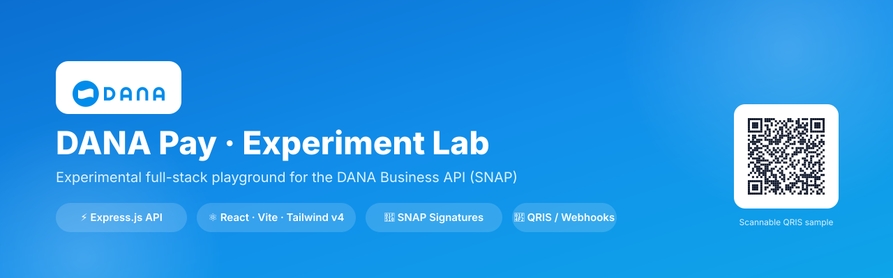
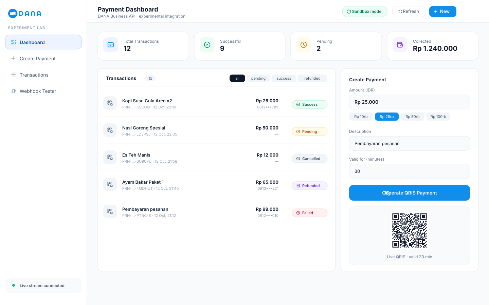
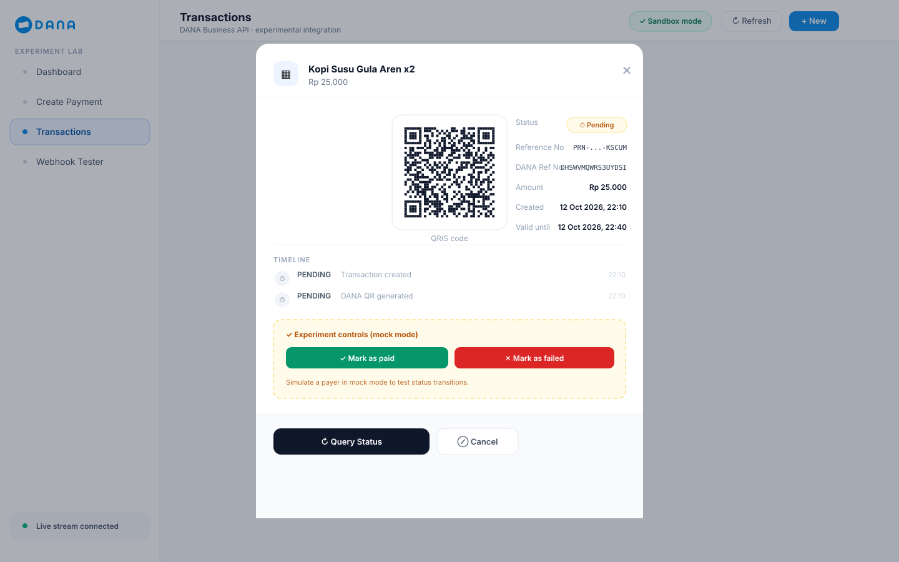
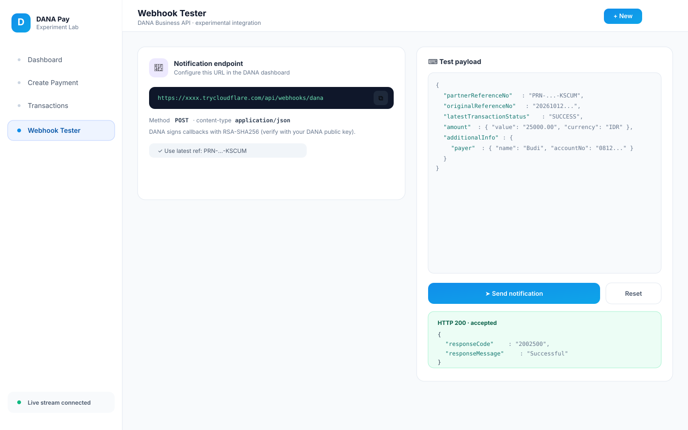
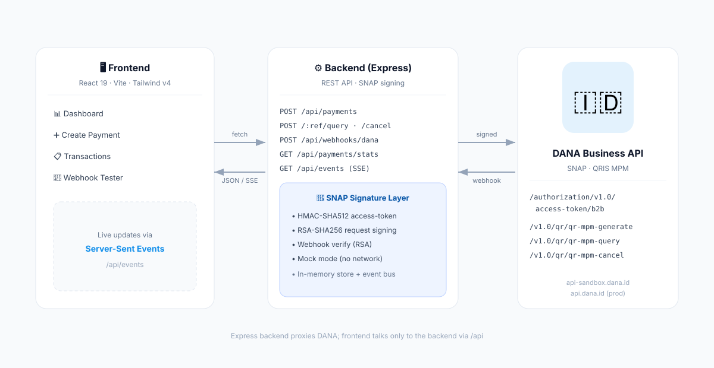

<p align="center">
  
</p>

<p align="center">
  <a href="LICENSE"></a>
  = 20">
  
  
  
  
  <a href="https://dashboard.dana.id/api-docs-v2/"></a>
  
</p>

> 💳 An **experimental** full-stack playground for the **DANA Business API**
> (Indonesian SNAP/QRIS standard) — create QRIS payments, poll status, receive
> webhooks, and watch a live operator dashboard update in real time.
>
> 🧪 Ships in **mock mode** by default, so you can explore the entire payment
> lifecycle **without any credentials**.

---

## 📚 Table of contents

- [✨ Features](#-features)
- [🖼 Screenshots](#-screenshots)
- [🏗 Architecture](#-architecture)
- [🧰 Tech stack](#-tech-stack)
- [🚀 Quick start](#-quick-start)
- [🔁 Payment lifecycle](#-payment-lifecycle)
- [🔐 Going live (sandbox / production)](#-going-live-sandbox--production)
- [📡 API reference](#-api-reference)
- [🗂 Project structure](#-project-structure)
- [🧪 Available scripts](#-available-scripts)
- [🤝 Contributing](#-contributing)
- [⚠️ Disclaimer](#️-disclaimer)
- [📄 License](#-license)

---

## ✨ Features

| Area | What you get |
| --- | --- |
| **Backend** | Express.js REST API · **SNAP request signing** (RSA-SHA256) · **HMAC-SHA512** access-token flow · QRIS MPM create / query / cancel · webhook receiver with signature verification · Server-Sent Events for live updates · zod validation · in-memory store (no DB) |
| **Frontend** | React 19 + Vite 8 + **TailwindCSS v4** + **Tabler Icons** · dashboard with live stats · payment creator with QR preview · filterable transaction list · detail modal (QR / timeline / query / cancel / simulation) · webhook tester |
| **DX** | **Mock mode** (no network) · keypair generator · hot reload on both sides · one command to run everything · CI workflow included |

---

## 🖼 Screenshots

### Dashboard — live stats, transactions & payment creator


### Payment detail — QR, timeline & experiment controls


### Webhook tester — copy the endpoint & fire sample payloads


---

## 🏗 Architecture



The React app talks **only** to the Express backend (`/api/*`, proxied by Vite in
dev). The backend handles all DANA communication: SNAP signatures, access tokens,
QRIS calls, and webhook verification. Live updates flow back over SSE.

---

## 🧰 Tech stack

**Backend**


`express` · `axios` · `zod` · `cors` · `morgan` · `nanoid` · `dotenv`

**Frontend**


`react` · `react-dom` · `vite` · `tailwindcss` · `@tailwindcss/vite` · `@tabler/icons-react`

---

## 🚀 Quick start

**Requirements:** Node.js **≥ 20** (developed on 24) and npm.

```bash
# 1. Clone
git clone https://github.com/FIQTOR/dana-payment-experiment.git
cd dana-payment-experiment

# 2. Install root + workspaces
npm install
npm run install:all

# 3. Configure the backend
cp backend/.env.example backend/.env
npm run keygen                # generates an RSA keypair in backend/certs

# 4. Run everything (backend :4000 + frontend :5173)
npm run dev
```

Then open **<http://localhost:5173>** 🎉

> ✅ Because `DANA_MOCK_MODE=true` by default, no DANA credentials are needed.
> Create payments, "pay" them via the simulation controls, and fire webhooks —
> entirely offline.

---

## 🔁 Payment lifecycle

```text
┌──────────────┐   POST /api/payments    ┌──────────────────┐   POST qr-mpm-generate   ┌──────────┐
│  Frontend    │ ──────────────────────► │  Express backend │ ───────────────────────► │   DANA   │
│  (React)     │ ◄────────────────────── │  (SNAP signing)  │ ◄─────────────────────── │   API    │
└──────────────┘   { qrContent, QR svg } └──────────────────┘   { referenceNo, qr }    └──────────┘
        ▲                                        ▲
        │            SSE /api/events             │   POST /api/webhooks/dana (async notify)
        └────────────────────────────────────────┘
```

1. **Create** → backend requests a QRIS MPM (`qr-mpm-generate`) → returns QR payload + SVG.
2. **Display** → dashboard shows the QR, amount, and validity window.
3. **Pay** → via *Experiment controls* (`POST /:ref/simulate`) in mock mode, or a real DANA webhook.
4. **Update** → the dashboard reflects the new status instantly over SSE; stats recompute.

---

## 🔐 Going live (sandbox / production)

DANA's sandbox is **not** credential-free — it's a real environment with sandbox-specific
keys. You need a **Partner ID**, **Client ID**, **Client Secret**, and an **RSA keypair**.

### Where to get credentials

1. Register at the **DANA Merchant Portal** → <https://dashboard.dana.id> (business/KYC required).
2. Create a **Sandbox** application.
3. Generate an RSA keypair — either from the dashboard or locally:
   ```bash
   npm run keygen            # → backend/certs/private_key.pem + public_key.pem
   ```
4. **Upload your public key** to the DANA dashboard.
5. **Download DANA's public key** (for webhook verification).
6. Copy your **Client ID / Client Secret / Partner ID / Merchant ID / Store ID**.

### Configure `backend/.env`

```env
DANA_MOCK_MODE=false
DANA_BASE_URL=https://api.sandbox.dana.id      # prod: https://api.dana.id
DANA_PARTNER_ID=...
DANA_CLIENT_ID=...
DANA_CLIENT_SECRET=...
DANA_MERCHANT_ID=...
DANA_STORE_ID=...
DANA_CHANNEL_ID=...

# your private key (signs requests)
DANA_PRIVATE_KEY_PATH=./certs/private_key.pem
# DANA's public key (verifies webhooks)
DANA_PUBLIC_KEY_PATH=./certs/dana_public_key.pem

# public URL DANA can reach for async notifications
PUBLIC_BASE_URL=https://your-tunnel.example.com
```

### Expose your local server for webhooks

DANA can't reach `localhost`. Use a tunnel:

```bash
npx cloudflared tunnel --url http://localhost:4000   # or: ngrok http 4000
```

Register the tunnel URL + `/api/webhooks/dana` as your **Finish Payment URL** in the
DANA dashboard, and set `PUBLIC_BASE_URL` to the tunnel origin.

### Verify your setup

```bash
curl -s http://localhost:4000/api/webhooks/config | jq
```

Look for `"mockMode": false`, `"hasPrivateKey": true`, `"hasPublicKey": true`,
and `"hasClientSecret": true`.

---

## 📡 API reference

Base URL: `http://localhost:4000/api`

### Payments

| Method | Endpoint | Description |
| --- | --- | --- |
| `POST` | `/payments` | Create a QRIS MPM payment |
| `GET` | `/payments` | List transactions (`?status=&limit=`) |
| `GET` | `/payments/:ref` | Get one transaction |
| `GET` | `/payments/:ref/qr.svg` | QR image (SVG) |
| `POST` | `/payments/:ref/query` | Poll DANA for the latest status |
| `POST` | `/payments/:ref/cancel` | Cancel a pending payment |
| `POST` | `/payments/:ref/simulate` | 🧪 Force a status (mock mode only) |
| `GET` | `/payments/stats` | Aggregate stats |

### Webhooks & events

| Method | Endpoint | Description |
| --- | --- | --- |
| `POST` | `/webhooks/dana` | DANA async notification receiver (signature-verified) |
| `GET` | `/webhooks/config` | Current configuration & key status |
| `GET` | `/events` | Server-Sent Events stream (live updates) |

<details>
<summary><b>Example — create a payment</b></summary>

```bash
curl -X POST http://localhost:4000/api/payments \
  -H "Content-Type: application/json" \
  -d '{"amount": 25000, "description": "Kopi Susu Gula Aren x2"}'
```

```jsonc
{
  "success": true,
  "data": {
    "partnerReferenceNo": "PRN-1791790460984-J3I3JH",
    "danaReferenceNo": "OHSWVMQWRS3UYDSI",
    "amount": { "value": 25000, "currency": "IDR" },
    "status": "PENDING",
    "qrContent": "00020101021226610014ID.CO.QRIS.WWW...",
    "qrImage": "data:image/svg+xml;base64,PHN2ZyB4bWxucz0i...",
    "validUntil": "2026-10-12T06:15:46.890Z"
  }
}
```
</details>

---

## 🗂 Project structure

```
dana-payment-experiment/
├── backend/                      # Express.js API (ESM)
│   ├── certs/                    # RSA keys (gitignored)
│   ├── src/
│   │   ├── config/               # Env-aware configuration
│   │   ├── controllers/          # Payment + webhook handlers
│   │   ├── middlewares/          # Error handling, raw-body capture
│   │   ├── routes/               # /api/payments, /api/webhooks
│   │   ├── services/             # DANA API client (SNAP)
│   │   ├── store/                # In-memory store + event bus
│   │   ├── utils/                # signature, qr, genKeyPair
│   │   └── server.js
│   └── .env.example
│
├── frontend/                     # React + Vite + Tailwind v4
│   └── src/
│       ├── components/           # UI building blocks (9 components)
│       ├── hooks/                # useTransactionEvents (SSE)
│       ├── lib/                  # api client + formatters
│       └── App.jsx
│
├── docs/
│   ├── DANA-API-MAPPING.md       # how code maps to DANA SNAP endpoints
│   └── screenshots/
│
└── .github/workflows/ci.yml      # lint + build + smoke test
```

---

## 🧪 Available scripts

**Root**

| Command | Description |
| --- | --- |
| `npm run dev` | Run backend **and** frontend together |
| `npm run install:all` | Install backend + frontend deps |
| `npm run keygen` | Generate an RSA keypair |
| `npm run build` | Build the frontend |
| `npm run lint` | Lint the frontend |

**Backend** (`cd backend`)

| Command | Description |
| --- | --- |
| `npm run dev` | Start with file watching |
| `npm start` | Start once |
| `npm run gen-key` | Generate an RSA-2048 keypair |

**Frontend** (`cd frontend`)

| Command | Description |
| --- | --- |
| `npm run dev` | Vite dev server |
| `npm run build` | Production build |
| `npm run preview` | Preview the production build |
| `npm run lint` | Lint with oxlint |

---

## 🤝 Contributing

Contributions are welcome! Please read [CONTRIBUTING.md](CONTRIBUTING.md) and the
[Code of Conduct](https://www.contributor-covenant.org/version/2/1/code_of_conduct/).

Ideas that would make great first PRs:

- 🧾 Add the **refund** endpoint (`/v1.0/debit/refund`)
- 🏦 Add **disbursement** to bank (`/v1.0/disbursement/...`)
- 🔑 Persist transactions in **SQLite/Postgres** instead of memory
- 📸 Real UI screenshots via Playwright
- 🧪 Automated tests (Vitest / Supertest)

---

## ⚠️ Disclaimer

This project is provided for **educational and experimental purposes only**.

- It is **not affiliated with, endorsed by, or connected to** DANA or
  PT Espay Debit Indonesia Koe.
- **DANA** and its logo are trademarks of their respective owners.
- You are responsible for complying with DANA's terms, sandbox usage policies,
  and all applicable financial regulations.
- **Never commit real private keys or client secrets.** This repo runs in mock
  mode by default; production credentials must stay in an untracked `.env`.

---

## 📄 License

Released under the [MIT License](LICENSE) © 2026 FIQTOR

<p align="center">Made with ☕ and the DANA Business API (SNAP) docs</p>
